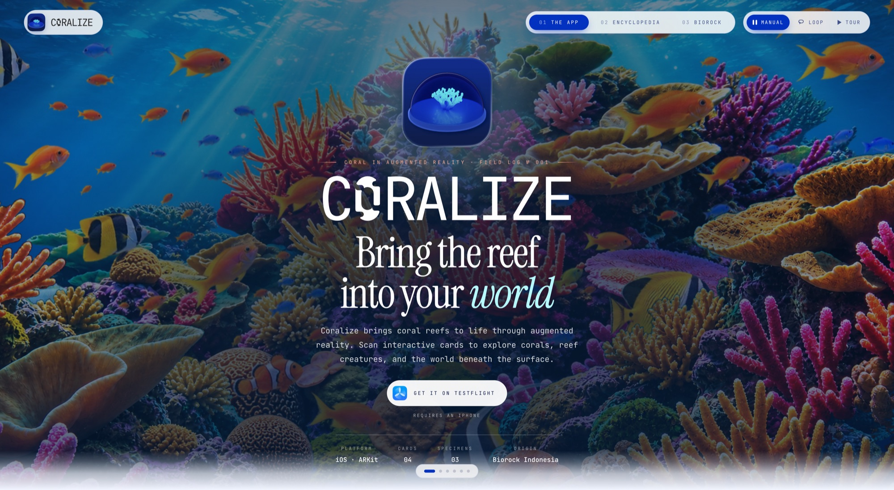
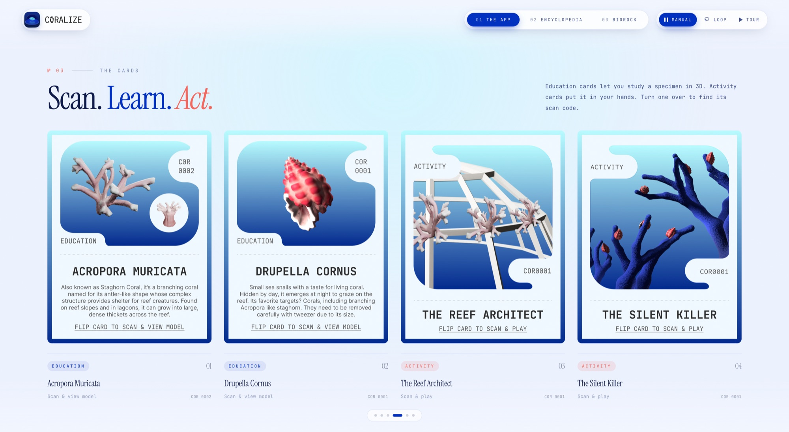
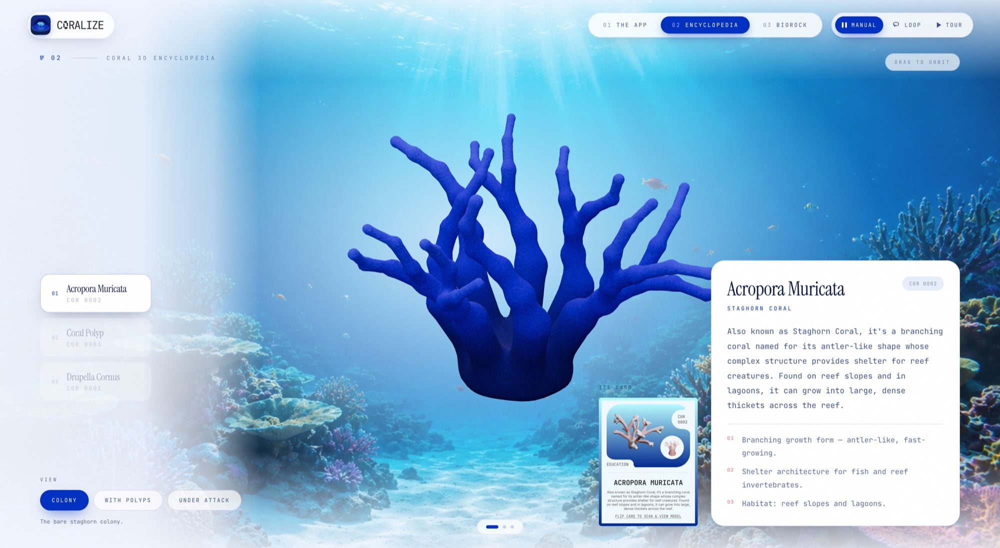
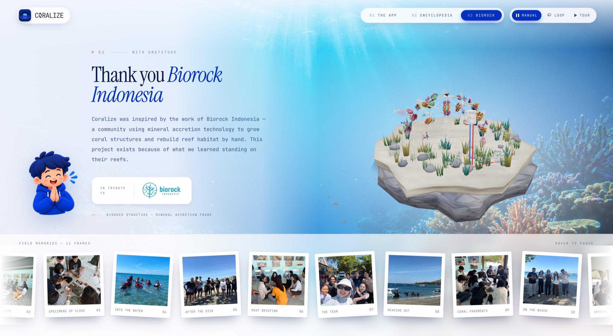

<div align="center">



# Coralize — Website

**The companion site for an augmented-reality coral field guide.**

[Live site](https://coralize.pages.dev) · [The iOS app](https://github.com/dapraws/CH5_Coralize) · [TestFlight](https://testflight.apple.com/join/YVCv7bSz)

<sub>React 19 · TypeScript · three.js · React Three Fiber · GSAP · Tailwind CSS 4 · Vite</sub>

</div>

---

## About

Coralize is an iOS app by team **Biorookie**. Point an iPhone at one of four printed postcards and a 3D coral colony stands up off the paper, tracked as you move the card. Two cards teach a specimen. Two are hands-on games.

This repository is the website for that project, designed and built by [Darrel](https://github.com/dapraws). It does three jobs: it introduces the app, it lets anyone explore the corals in 3D without owning a card, and it thanks the people the project grew out of. The app itself lives in its own repo, [CH5_Coralize](https://github.com/dapraws/CH5_Coralize).

It was first built to run on a booth display at an exhibition, so it has two modes. On a large screen it is a self-running slide show with nothing to scroll. On a phone it is an ordinary scrolling page.

---

## 1. The App

The first screen introduces Coralize over a layered, full-saturation reef with a parallax that responds to the pointer. From there it walks through how the app works, the four printed cards, how to install it, and the team behind it.



The card set mirrors the print design: two **education** cards (Acropora Muricata, Drupella Cornus) and two **activity** cards (The Reef Architect, The Silent Killer). Each one turns over to show its scan code.

---

## 2. Coral 3D Encyclopedia

Orbit a staghorn coral, switch between variants of the same specimen, and read what the printed card says about it. Acropora can be seen as a bare colony, with its polyps extended, or under attack from *Drupella* snails. The polyp can be viewed whole or sliced open to show its anatomy.

It is the one part of the site that needs no card and no iPhone.



---

## 3. Biorock

A thank-you to **Biorock Indonesia**, the community whose mineral-accretion reef structures inspired the project. It pairs their structure as an interactive 3D model with a strip of photographs from the team's time with them.



---

## Built with

| | |
|---|---|
| **App** | React 19, TypeScript, Vite |
| **3D** | three.js through React Three Fiber and drei |
| **Motion** | GSAP |
| **Styling** | Tailwind CSS 4, with Instrument Serif and JetBrains Mono |
| **Hosting** | Cloudflare Pages |

A few things worth pointing out:

- **A hand-written show controller** drives the kiosk mode. It handles playback modes, one-gesture-one-slide trackpad input, an idle reset, and deep links. There is no scroll library.
- **3D that works offline.** Models are compressed with meshopt (61MB down to 23MB), and the lighting environment is bundled, so nothing fetches from a CDN at runtime.
- **One site, two layouts.** Below 900px the slide show turns into a normal scrolling page with its own tap-friendly interactions.

---

## Run it locally

```bash
npm install
npm run dev      # http://localhost:5173
npm run build    # typecheck + production build
```

---

<sub>This is a showcase repository, not an open-source project. The artwork, 3D models and photographs belong to Biorookie and the people pictured, and are not licensed for reuse.</sub>
