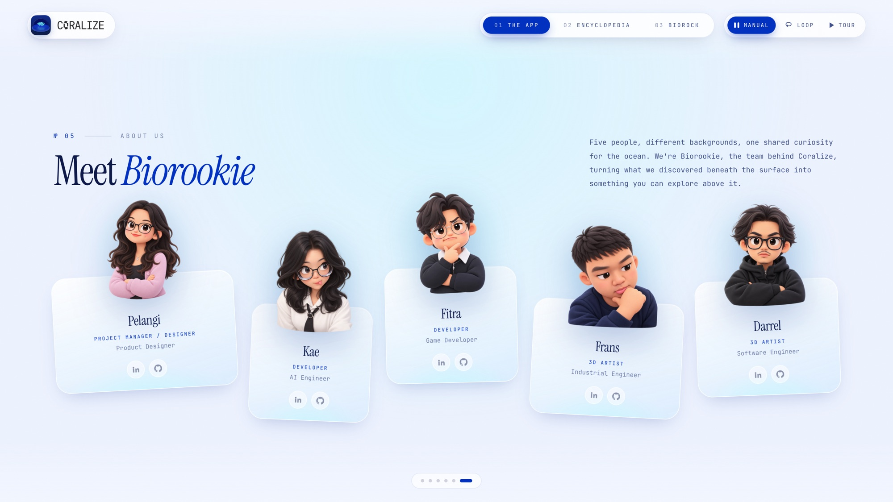

<div align="center">


# Coralize

**An augmented-reality field guide to coral reefs, and the website that goes with it.**

[Live site](https://coralize.pages.dev) · [iOS app repo](https://github.com/dapraws/CH5_Coralize) · [TestFlight](https://testflight.apple.com/join/YVCv7bSz)

<sub>React 19 · TypeScript · three.js · React Three Fiber · GSAP · Tailwind CSS 4 · Vite</sub>

</div>

---

## About

Coralize is an iOS app that turns printed postcards into AR. Point your phone at a card and a 3D coral colony stands up on top of it. Our team, Biorookie, made the app, and its code lives in [CH5_Coralize](https://github.com/dapraws/CH5_Coralize).

This repo is the website I designed and built for it. It started as a screen for an exhibition booth, so on a big display it plays itself like a slide show, and on a phone it's a regular scrolling page.

---

## The App

The first screen sets the mood with a full-colour reef that shifts with the pointer, then explains how the app works and shows the four printed cards: two that teach a specimen, two that are small games.


<p align="center">
  
  &nbsp;&nbsp;
  
</p>
<p align="center"><sub>The same site on a phone.</sub></p>

---

## Coral 3D Encyclopedia

<table>
  <tr>
    <td width="34%" valign="top">
      <br>
      Orbit a staghorn coral and switch between versions of the same specimen: the bare colony, the colony with its polyps out, or under attack from <i>Drupella</i> snails.
      <br><br>
      The polyp can be viewed whole or cut open to show its anatomy.
      <br><br>
      It's the one part of the site you can use without a card or an iPhone.
    </td>
    <td width="66%">
      
    </td>
  </tr>
</table>

---

## Biorock

A thank-you page for **Biorock Indonesia**, the community whose mineral-accretion reefs inspired the project. Their structure is an interactive 3D model, with photos from the team's time with them drifting along the bottom.


---

## The team

Five people from different backgrounds, brought together by an interest in the ocean.

<p align="center">
  
</p>

| | Role | Background | |
|---|---|---|---|
| **Pelangi** | Project Manager / Designer | Product Designer | [LinkedIn](https://linkedin.com/in/pelangi-romadoni-a12075254/) · [GitHub](https://github.com/pelangiromadoni222) |
| **Kae** | Developer | AI Engineer | [LinkedIn](https://linkedin.com/in/teresakae/) · [GitHub](https://github.com/teresakae) |
| **Fitra** | Developer | Game Developer | [LinkedIn](https://linkedin.com/in/fitraramadhans/) · [GitHub](https://github.com/fnt4sia) |
| **Frans** | 3D Artist | Industrial Engineer | [LinkedIn](https://linkedin.com/in/fransiskus-risky-gawahi-a00202310/) · [GitHub](https://github.com/gawahirisky24-netizen) |
| **Darrel** | 3D Artist | Software Engineer | [LinkedIn](https://linkedin.com/in/dapraws) · [GitHub](https://github.com/dapraws) |

---

## Built with

| | |
|---|---|
| **App** | React 19, TypeScript, Vite |
| **3D** | three.js through React Three Fiber and drei |
| **Motion** | GSAP |
| **Styling** | Tailwind CSS 4, Instrument Serif and JetBrains Mono |
| **Hosting** | Cloudflare Pages |

A few things I'm happy with:

- The kiosk mode runs on a hand-written controller with three playback modes, one-swipe-one-slide trackpad input, an idle reset and deep links. There's no scroll library.
- 3D works offline. Models are compressed with meshopt (61MB down to 23MB) and the lighting environment is bundled, so nothing is fetched from a CDN at runtime.
- Below 900px the slide show becomes a normal page with its own tap-friendly interactions.

## Run it

```bash
npm install
npm run dev      # http://localhost:5173
npm run build    # typecheck + production build
```
