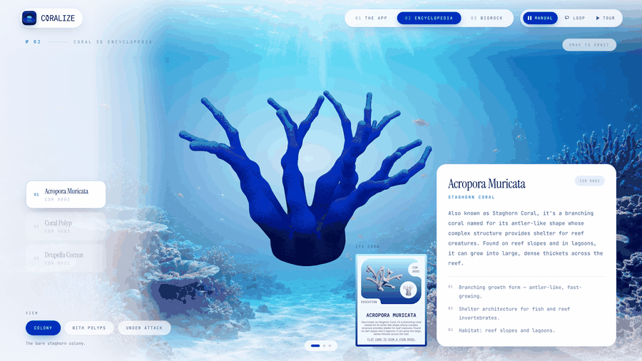
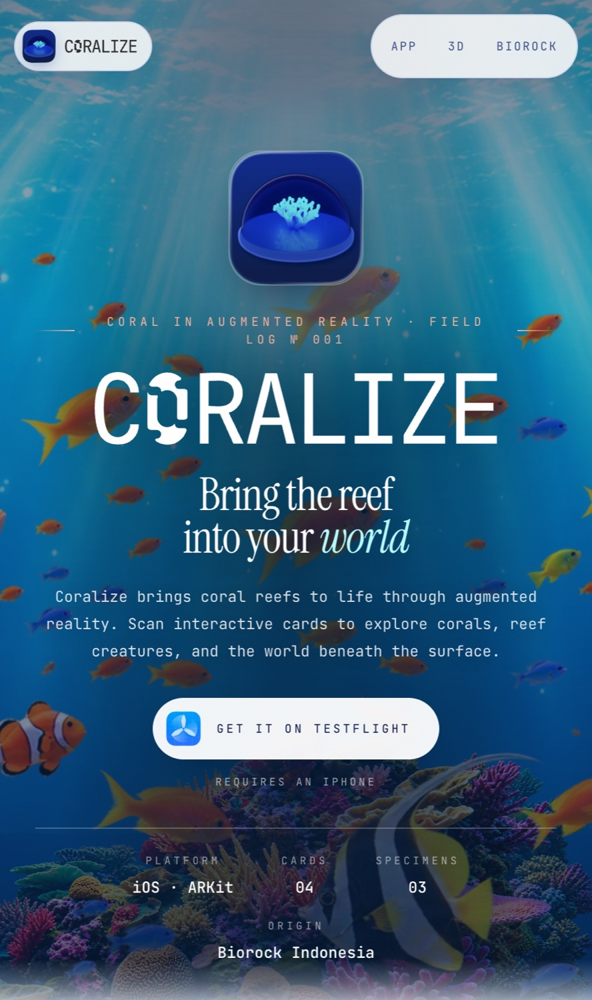
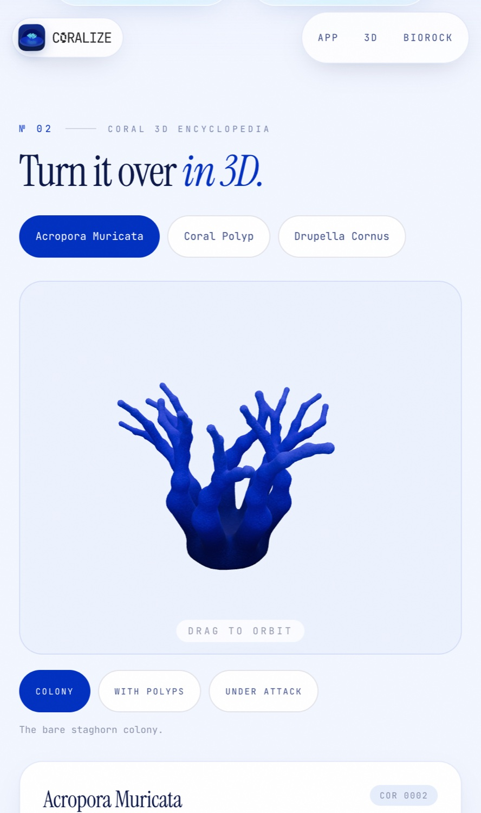

<div align="center">


# Coralize

**An augmented-reality field guide to coral reefs, by team Biorookie.**

[Live site](https://coralize.pages.dev) · [TestFlight](https://testflight.apple.com/join/YVCv7bSz)

</div>

Coralize turns printed postcards into 3D coral in augmented reality. This is the website that goes with the iOS app: an introduction to the app and its cards, an interactive 3D coral encyclopedia, and a tribute to Biorock Indonesia.

<p align="center">
  
</p>

<table>
  <tr>
    <td width="36%"></td>
    <td width="36%"></td>
    <td width="28%" align="center">
      
      
    </td>
  </tr>
</table>

---

## Team

<table>
  <tr>
    <td align="center" valign="top" width="20%">
      <br>
      <b>Pelangi</b><br>
      Project Manager / Designer<br>
      <sub>Product Designer</sub><br>
      <a href="https://linkedin.com/in/pelangi-romadoni-a12075254/"></a>&nbsp;
      <a href="https://github.com/pelangiromadoni222"></a>
    </td>
    <td align="center" valign="top" width="20%">
      <br>
      <b>Kae</b><br>
      Developer<br>
      <sub>AI Engineer</sub><br>
      <a href="https://linkedin.com/in/teresakae/"></a>&nbsp;
      <a href="https://github.com/teresakae"></a>
    </td>
    <td align="center" valign="top" width="20%">
      <br>
      <b>Fitra</b><br>
      Developer<br>
      <sub>Game Developer</sub><br>
      <a href="https://linkedin.com/in/fitraramadhans/"></a>&nbsp;
      <a href="https://github.com/fnt4sia"></a>
    </td>
    <td align="center" valign="top" width="20%">
      <br>
      <b>Frans</b><br>
      3D Artist<br>
      <sub>Industrial Engineer</sub><br>
      <a href="https://linkedin.com/in/fransiskus-risky-gawahi-a00202310/"></a>&nbsp;
      <a href="https://github.com/gawahirisky24-netizen"></a>
    </td>
    <td align="center" valign="top" width="20%">
      <br>
      <b>Darrel</b><br>
      3D Artist<br>
      <sub>Software Engineer</sub><br>
      <a href="https://linkedin.com/in/dapraws"></a>&nbsp;
      <a href="https://github.com/dapraws"></a>
    </td>
  </tr>
</table>

---

## Built with

| Technology | What it does here |
|---|---|
| **React 19 + TypeScript** | The interface, written as typed components. |
| **Vite** | Dev server and production build. |
| **Tailwind CSS 4** | Styling, with Instrument Serif and JetBrains Mono as the type pairing. |
| **three.js, React Three Fiber, drei** | The interactive 3D coral viewers: orbit controls, lighting and model loading. |
| **GSAP** | Slide transitions, entrance animation and the parallax reef in the hero. |
| **Custom show controller** | Runs the full-screen display mode: auto-play, keyboard and trackpad stepping, and an idle reset. |
| **Cloudflare Pages** | Hosting. |

3D models are compressed with meshopt (61MB down to 23MB) and the lighting is bundled with the site, so the 3D views work without any external requests. Below 900px the slide show becomes a normal scrolling page.

## Run locally

```bash
npm install
npm run dev
```
